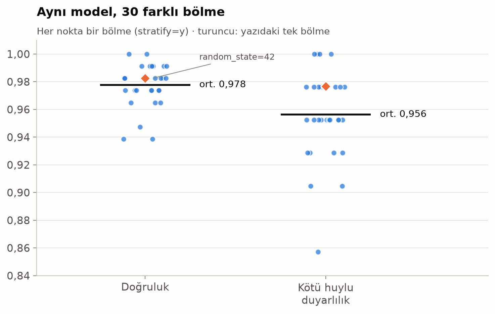

# Meme kanseri sınıflandırma: NumPy ile sıfırdan lojistik regresyon

Bu projede meme tümörlerini iyi huylu ve kötü huylu olarak sınıflandıran bir lojistik regresyon modeli NumPy ile yazıldı. İleri geçiş, kayıp fonksiyonu, gradyan ve ağırlık güncellemesi hazır bir kütüphane çağrısı olmadan kodda yer alıyor.

Proje, MIUUL eğitimindeki bir alıştırmayı temel alıyor. Alıştırmanın üzerine sklearn karşılaştırması, 30 farklı bölmeyle tekrar, gradyan kontrolü, eşik analizi ve grafikler eklendi.

## Neden lojistik regresyon?

Lojistik regresyon, sigmoid aktivasyonlu tek nöronlu bir sinir ağı olarak düşünülebilir. Derin öğrenmedeki eğitim döngüsü de aynı dört adıma dayanır: ağırlıklarla çarpıp bias eklemek, aktivasyondan geçirmek, kaybı ölçmek ve ağırlıkları gradyanın tersi yönünde güncellemek. Tek nöronda bu adımların her biri birkaç satır koda sığıyor ve ara değerleri tek tek incelemek mümkün.

## Veri

scikit-learn içindeki Wisconsin meme kanseri veri seti kullanıldı: 569 örnek, 30 sayısal özellik. Özellikler, ince iğne aspirasyonu görüntülerindeki hücre çekirdeklerinden ölçülüyor.

Etiketlerde `0` kötü huylu (malignant), `1` iyi huylu (benign) anlamına geliyor. Bu yüzden kötü huylu sınıfın metrikleri `pos_label=0` ile hesaplanıyor. Veride 212 kötü huylu ve 357 iyi huylu örnek var.

## Sonuçlar

Veri %80 eğitim ve %20 test olarak bölündü (`random_state=42`). `StandardScaler` yalnızca eğitim verisiyle fit edildi. Model öğrenme oranı 0,1 ile 100 epoch eğitildi.

| Ölçüt | Bu model (NumPy) | sklearn `LogisticRegression` |
| --- | --- | --- |
| Doğruluk | 0,982 | 0,974 |
| Kötü huylu duyarlılık (recall) | 0,977 (42/43) | 0,953 (41/43) |
| ROC AUC | 0,999 | 0,997 |

sklearn varsayılan olarak L2 düzenlileştirme kullanıyor, bu modelde düzenlileştirme yok. Aradaki fark 114 örnekte tek bir tahmine karşılık geliyor. Bu farka bakarak bir modelin daha iyi olduğunu söylemek doğru olmaz.

### Tek bölme ne kadar güvenilir?

Aynı model 30 farklı rastgele bölmede (sınıf oranları korunarak) eğitildiğinde doğruluk ortalama 0,978 çıktı. Standart sapma 0,015, en düşük değer 0,939, en yüksek değer 1,000. Kötü huylu duyarlılık ortalama 0,956 iken bir bölmede 0,857'ye düştü. Ana sonuçtaki 0,982 bu dağılımda ortalamanın biraz üstünde kalıyor.



### Model nerede yanılıyor?

Test setinde iki hata var ve ikisi farklı türden:

- İyi huylu bir tümör, P(iyi huylu) = 0,4993 ile eşiğin hemen altında kaldı.
- Kötü huylu bir tümöre model P(iyi huylu) = 0,72 verdi. Bu hata sınırda değil.

İki örneğin ortalama yarıçap, doku, çevre ve alan değerleri birbirine çok yakın (yarıçap 13,34 ve 13,80). Bu boyut özelliklerine bakarak iki tümörü ayırmak zor görünüyor. Model 30 özelliğin hepsini kullandığı için hatanın tam nedeni için diğer özelliklere de bakmak gerekir.

### Gradyan kontrolü

Elle türetilen gradyan, sayısal gradyanla karşılaştırıldı. En büyük göreli fark yaklaşık 3,7 × 10⁻¹⁰ çıktı. Bu fark kayan nokta hassasiyeti düzeyinde.

## Dosyalar

```
breast_cancer_model.py   model, deneyler ve ana akış
plots.py                 6 grafik (figures/ klasörüne PNG olarak kaydedilir)
figures/                 grafikler
```

## Çalıştırma

```bash
pip install numpy pandas matplotlib seaborn scikit-learn
python breast_cancer_model.py
```

Betik sonuçları ekrana yazar ve grafikleri `figures/` klasörüne kaydeder. Keşifsel analiz grafiklerini de görmek için dosyanın başındaki `RUN_EDA` değerini `True` yapabilirsin.

## Grafikler

| Dosya | İçerik |
| --- | --- |
| `fig1_korelasyon.png` | 10 "ortalama" özellik arasındaki korelasyon |
| `fig2_kayip_egrisi.png` | Eğitim ve test kaybı, 100 epoch |
| `fig3_karisiklik_matrisi.png` | Karışıklık matrisi |
| `fig4_bolme_degiskenligi.png` | 30 bölmede doğruluk ve kötü huylu duyarlılık |
| `fig5_esik_analizi.png` | Eşiğe göre yanlış negatif ve yanlış pozitif sayısı |
| `fig6_gradyan_kontrolu.png` | Analitik ve sayısal gradyanın karşılaştırması |

## Sınırlamalar

- Veri seti küçük ve tek bir kaynaktan geliyor. Sonuçların başka hastanelerin verisine genellenip genellenmediğini bu veriyle bilemeyiz.
- Ayrı bir doğrulama seti yok. Öğrenme oranı, epoch sayısı ya da eşik test setine bakılarak ayarlanırsa test skoru iyimser olur.
- Eşik analizi yalnızca dengeyi göstermek için çizildi. Bu analizden bir eşik seçilmedi.
- Bu bir öğrenme projesi. Klinik karar desteği için kullanılmamalı.

## Sonraki adımlar

1. Modele L2 düzenlileştirmeyi elle eklemek.
2. Gizli katmanlı küçük bir sinir ağı yazıp geri yayılımı elle türetmek.
3. Aynı ağı PyTorch ile yazıp autograd gradyanlarını elle hesaplananlarla karşılaştırmak.

## Kaynaklar

- Street, W. N., Wolberg, W. H. ve Mangasarian, O. L. (1993). Nuclear feature extraction for breast tumor diagnosis. *Proceedings of SPIE*, 1905, 861–870. https://doi.org/10.1117/12.148698
- Wolberg, W., Mangasarian, O., Street, N. ve Street, W. (1993). *Breast Cancer Wisconsin (Diagnostic)* [Veri seti]. UCI Machine Learning Repository. https://doi.org/10.24432/C5DW2B
- Varoquaux, G. (2018). Cross-validation failure: Small sample sizes lead to large error bars. *NeuroImage*, 180(A), 68–77. https://doi.org/10.1016/j.neuroimage.2017.06.061
- Goodfellow, I., Bengio, Y. ve Courville, A. (2016). *Deep Learning*. MIT Press. http://www.deeplearningbook.org/
- Pedregosa, F. vd. (2011). Scikit-learn: Machine learning in Python. *Journal of Machine Learning Research*, 12, 2825–2830.
- Harris, C. R. vd. (2020). Array programming with NumPy. *Nature*, 585, 357–362. https://doi.org/10.1038/s41586-020-2649-2
